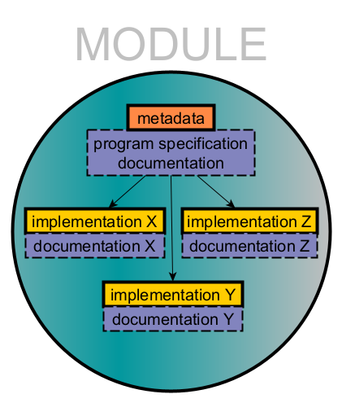
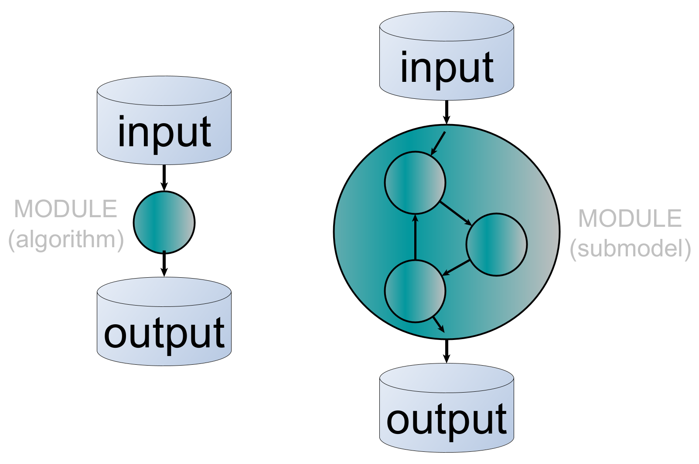

## What is ABM of SES in archaeology?

Agent-based modelling (ABM) has in recent years developed into an important methodological tool in archaeological research, especially when approaching questions from the perspective of socio-ecological systems (SES) as coupled human and natural spheres exchanging energy and resources.

ABM focuses on the dynamics and actions of individual agents as computational entities that act autonomously and can represent social agents that interact with each other and their environment. When designing an agent-based model, the aim is not to mimic the patterns of our data but to recreate the mechanisms that, under certain conditions, will generate those patterns.

**Google Groups**: Sign in to Google Groups and search <emph>nassaabm</emph> to request membership or by contacting [Andreas Angourakis](andros.spica@gmail.com).

**Zotero group**: Members are welcome to join our Zotero group and help to compile and curate an extensive public collection of references related to our field. URL: [https://www.zotero.org/groups/5452452/nassa](https://www.zotero.org/groups/5452452/nassa)

## NASSA library



---

The NASSA library is an **open-source** repository collecting **stable, version-controlled modules** to be used inside or in connection to **(agent-based) simulation models** that aim at representing **socio-ecological systems** and addressing **archaeological questions**.

NASSA provides a **standardised module format** ([NASSA-schema](https://github.com/Archaeology-ABM/NASSA-schema)) and encourages programming good practices, as well as a framework for the **review and curation of modules** using [GitHub code review feature](https://github.com/features/code-review). NASSA maintains a [software tool](https://github.com/Archaeology-ABM/nassa-hs) to validate modules automatically based on the schema.

Modules are **authored submissions**, individually **licensed** and **citable** as other academic publications. However, as a community resource, they remain open for **further development and revision** by the original author(s) or any contributor, under the curation of NASSA members.

## What is a NASSA module?

A NASSA module is a **program specification and implementation** in one or more programming languages, accompanied by its unique **metadata** and **documentation** designed to facilitate its long-term and community-wide understanding and reuse. All modules are ultimately **algorithms**, i.e., finite sequences of formal instructions that receive an **input** and generate an **output**.

The NASSA library schema classifies modules as **algorithms** only if their functionality is indivisible. Alternatively, modules are classified as **submodels if they contain more than one algorithm that can be explicitly defined as separate modules.  

  

    
  

  

    
  

